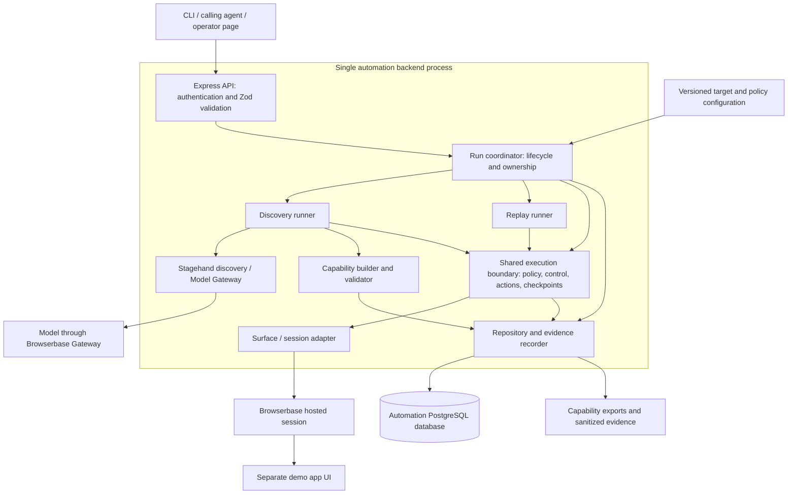

# System Design

Working design document following our agreed sequence:

Functional Requirements → Non Functional Requirements → Core Entities (Database Schema) → API Design → High Level Design → Deep Dives

Current stage: **Implementation planning, reviewed against the assignment.** [IMPLEMENTATION_PLAN.md](IMPLEMENTATION_PLAN.md) preserves stable INT IDs and makes the complete balance baseline plus documentation independently ready at INT-022. Contact updates and deeper restart recovery are planned follow-on work. The selected stack is in [STACK.md](STACK.md); workflow scope is in [DEMO_WORKFLOW.md](DEMO_WORKFLOW.md). All implementation criteria remain unverified.

Scope clarification after assignment review: the detailed recovery/idempotency designs below describe the target design, not a requirement to implement every hardening mechanism before baseline readiness. Safe stopping, explicit action uncertainty, finite session lifetime, and no blind redispatch remain baseline. Follow the reviewed implementation plan for staged delivery.

This document records design decisions as we work through them. [ACCEPTANCE.md](ACCEPTANCE.md) remains the detailed verification checklist. The assignment's final `REPORT.md` will be written from the agreed design using its required headings.

## 1. Functional Requirements

### Purpose and actors

Enable an AI agent to accomplish tasks in applications that can only be operated through their UI. Learn a task through a real LLM-driven discovery run, save it as a reusable capability, and execute that capability on subsequent requests without model decisions.

For requirements discussion, distinguish three roles. These do not imply separate accounts, services, or interfaces:

- **Capability author:** supplies the goal and target for discovery and inspects the resulting capability. This may be a developer or operator.
- **Caller:** supplies invocation inputs and receives a result. This may be an upstream AI agent or a person using the demo interface.
- **Human operator:** receives an intervention request and takes control when automation cannot safely continue.

### FR-1 — Discover and save a reusable capability

**A capability author should be able to submit a natural-language goal and a target application, have the system attempt the task through the live UI, and obtain a reusable capability after a successful run.**

Required behavior:

- Accept a goal and target entry point.
- Use an LLM to observe the application, decide what to do, and perform UI actions through a non-trivial multi-step flow.
- Finish with a successful outcome or an explicit stopping/intervention reason.
- After success, save a versioned, reviewable capability that describes its actions, targets, typed inputs, typed outputs, and success condition. It must be usable independently of the raw model transcript.
- Make the saved capability available for inspection and later invocation. This does not require a catalog UI or an approval workflow.

**Completion example:** an author can inspect the saved capability, understand what inputs it accepts and outputs it returns, and use it in FR-2.

Acceptance mapping: DISC-01–03, ART-01–05.

### FR-2 — Invoke a saved capability and receive a meaningful result

**A caller should be able to supply a saved capability and invocation inputs, have the system execute it through the UI without model decisions, and receive its outputs or a clear outcome.**

Required behavior:

- Load a saved capability and apply the caller's parameter values, including values different from the discovery run.
- Execute the recorded flow, evaluate its success condition, and return its declared outputs when successful.
- Distinguish a legitimate business outcome, such as a missing record, from an automation failure.
- Recognize supported recoverable conditions and perform the defined recovery; stop or request intervention when execution cannot safely continue.
- On failure, return enough context to identify the failed step, expected state, and observed state.

**Completion example:** the same saved capability can be invoked with a new input, and the caller can distinguish successful output, a known business outcome, and an execution failure.

Acceptance mapping: REP-01–08; ART-03–04.

### FR-3 — Take over a blocked run and hand control back

**A human operator should be able to receive an intervention request, take control of the same live session, perform manual actions, and hand control back so the run can resume or complete.**

Required behavior:

- Detect a blocked/stuck run and expose an intervention request with its goal/capability, current step, current state, and reason for stopping.
- Pause automation and identify who currently controls the session.
- Allow the operator to act in the existing live session while automation is paused.
- Accept a hand-back signal and continue from the resulting session state when safe.
- Preserve run context and record the operator's actions across the handoff.

**Completion example:** a person resolves a condition in the paused session, then automation resumes in that same session with a continuous record of what happened.

Acceptance mapping: HUM-01–05.

### Supporting functional requirements

These apply across the three capabilities; grouping them here does not make them optional.

- **FR-4 — Configure and enforce permitted operations.** The person configuring the system can specify permitted targets/actions and the treatment of risky actions. Discovery and replay enforce that policy. The specific policy format and risky-action treatment remain design decisions. Acceptance: SAFE-01–02.
- **FR-5 — Inspect execution evidence.** An author/operator can inspect structured records of what happened and why, including richer failure evidence and manual-action history. Evidence must respect sensitive-data protections, to be specified in the non-functional requirements. Acceptance: OBS-01–02, HUM-05, SAFE-03.

### Scope boundaries

- Build a fictional internal credit-union staff servicing portal with institution/operator/session and active-member context, connected search/overview/account inquiry/details, and realistic runtime states. Implement primary-savings balance lookup first; a preferred-email update with human commit is proposed as a second capability in the same app. See DEMO_WORKFLOW.md for scope.
- Discovery must include a genuine model-driven run against a live UI. Deterministic replay and live-session handoff must also work.
- The operator interface may be minimal. A full operator console is not required.
- Desktop support and reuse across tenants require a credible design explanation, not additional working implementations in the baseline.
- Capability catalogs, code generation, approval scoring, assisted model recovery, and other stretch features are not baseline functional requirements.
- System qualities and proposed verification targets are described in section 2. They do not prescribe implementation technologies.

### Demo target and repository setup

**Decision:** build a fictional credit-union back-office staff portal in this repository. The baseline is a connected Staff workspace → Member Search → Member Overview → Account Inquiry → Account Details flow, with persistent staff/member context, a framed servicing workspace, and table-based controls. Show separately labeled Current and Available Balance so correct extraction is tested. INT-006 now implements and verifies those screens with PostgreSQL-backed data; see [PORTAL.md](PORTAL.md). INT-012 adds controlled contextual runtime exceptions. Contact Maintenance adds a later review/commit path. DEMO_WORKFLOW.md is the detailed portal specification. The generic INT-001 shell is scaffolding only and does not satisfy portal completion.

Repository setup should accommodate:

- Separate source directories for the automation system and the demo target, so each has a clear responsibility and can be run independently.
- A documented way to start both components for the end-to-end demonstration.
- Synthetic fixtures and repeatable scenario setup/reset for the demo target, with the exact scenarios to be defined later.
- Integration tests that exercise the automation system against the running target through its UI. Test setup may seed/reset the target; discovery and replay must not use its internal data or APIs to bypass UI interaction.
- Root-level design and acceptance documents and the required submission evidence directory.

Directory names, workspace tooling, frameworks, and runtime boundaries remain open until the relevant design stage. These setup needs do not require designing the demo application's internals now.

### Open decisions

- Balance lookup is agreed; should the proposed preferred-email update with human commit be included as the second capability?
- What inputs, outputs, and business outcomes belong to that workflow?
- Which runtime condition will demonstrate human takeover and safe resumption?

[DEMO_WORKFLOW.md](DEMO_WORKFLOW.md) defines the agreed balance-lookup workflow and proposes a second contact-update capability, including contracts, business outcomes, and real human intervention. Detailed choices for the write capability remain for review.

## 2. Non Functional Requirements

These describe how well and under what constraints the functional capabilities must operate. They are proposed design requirements, not claims about an implementation. Verification examples extend the assignment into concrete design targets; they are not additional requirements attributed to the assignment.

Priority: correctness and safety first, then reproducible execution and diagnosis. Performance improvements must preserve those properties.

### NFR-1 — Correct execution and safe control transfer

**The system should prefer a clear stop or escalation over an unverified action or a false success.**

- Replay uses recorded rules rather than model decisions. Equivalent inputs and observed application states produce equivalent decisions; changing live data may legitimately change outputs.
- Success requires the declared checkpoint and output contract to be satisfied.
- An ambiguous/missing target or an unexpected state must not cause a guessed action or blind continuation.
- At most one controller has authority to act in a session at a time. Automation performs zero actions during human ownership; resumption checks that the resulting state permits continuation.
- Recovery must not blindly repeat a potentially consequential action whose result is unknown. If completion cannot be established safely, stop or escalate.

**Verification:** test incorrect checkpoints, ambiguous targets, uncertain action outcomes, and takeover/resume transitions. Assert zero false successes and zero automated actions during human ownership in these scenarios. These are acceptance assertions, not a claim of perfect production reliability.

Acceptance mapping: REP-01, REP-03–08, HUM-02–05.

### NFR-2 — Policy enforcement and sensitive-data protection

**The system should enforce its execution policy throughout a run and minimize sensitive information retained or exposed.**

- Discovery and replay are subject to the same configured restrictions. Model output and target-application content cannot override those restrictions.
- An automated action whose permission cannot be established must not execute. Risky actions receive the declared conservative treatment.
- Persist no credentials, tokens, or raw sensitive personal data in capabilities, logs, screenshots, snapshots, or traces. Retained evidence must be sanitized; if richer evidence cannot be safely retained, record that limitation.
- Send only the observations needed for discovery to the model. The prototype uses synthetic application data; redacting stored logs alone is not a guarantee about data sent to a provider.
- Keep runtime secrets outside source control and saved capabilities.

**Verification:** attempt policy violations through both execution paths, including instructions embedded in target content; use synthetic sensitive markers to inspect model-bound observations and retained evidence. Document redaction coverage and limitations rather than claiming regulatory certification.

Acceptance mapping: SAFE-01–04, OBS-02.

### NFR-3 — Bounded execution time and model cost

**Automated execution should have explicit resource limits and should not depend on model availability during replay.**

- Deterministic replay makes **zero model calls**. This is a proposed prototype target that also makes the assignment's no-model-decisions requirement easy to demonstrate.
- Discovery has configurable finite step and model-call/time limits. UI waits and recovery attempts are bounded; exhaustion produces a clear stop or intervention request.
- A stalled model request or application transition must not leave automation running indefinitely.
- Waiting for a human is a distinct paused state with no automated actions or repeated model polling. The operator-wait expiry policy will be decided during session design.
- Record discovery/replay duration, retries, and model usage where available so performance and cost can be evaluated.

**Verification:** disable model access during replay; inject stalled requests and slow/failed UI transitions; confirm configured limits terminate automated work with a diagnosable result. Record baseline timings once the workflow is chosen.

No end-to-end latency SLA, percentage speedup, or dollar budget is assumed yet. Human response time and application latency must be distinguished from automation overhead before setting those targets.

Acceptance mapping: DISC-03, REP-01, REP-03, REP-06–08, OBS-01.

### NFR-4 — Reproducibility, retained artifacts, and diagnosability

**A reviewer should be able to reproduce the demonstration and understand a run without relying on the original process or the author's memory.**

- A completed saved capability remains loadable and usable in a later process invocation. Replay does not depend on the discovery transcript remaining in memory.
- From a clean checkout, documented setup and synthetic scenario reset steps reproduce the chosen demonstration conditions. This does not require identical LLM discovery decisions on every run.
- Evidence ties each run to its capability version, relevant configuration, step/outcome history, and any intervention, without retaining sensitive values.
- Failures identify the step, expected state, observed state, and a reference to sanitized richer evidence when available.
- Live-session continuity is required during a normal human handoff. Automatic restoration of a live session after a process/browser crash is not a baseline requirement; a lost session must not be represented as successful completion.

**Verification:** save a capability, restart the runner, and replay it; follow the documented demonstration from a clean checkout; reconstruct a failure and handoff from retained evidence.

Acceptance mapping: ART-01, ART-05, OBS-01–02, HUM-05, DEL-01–04.

### NFR-5 — Extensibility with a small initial operating scope

**The design should permit additional surfaces and tenant variants without requiring a new execution engine for each one.**

- Keep the recorded flow conceptually separate from surface-specific observation and action mechanisms. Explain dependencies on DOM structure, accessibility, screenshots, or other chosen signals.
- Explain how vendor-level capabilities could be specialized safely for tenant configuration/version differences, and how incompatibility or drift would be detected.
- Keep demo-app internals separate from automation logic. Scenario setup can seed/reset data; discovery and replay interact with the running target through its UI.
- Proposed initial operating scope: one local target and one active automation session at a time. Concurrent execution and isolation across tenants are future design considerations, not prototype throughput commitments.

**Verification:** review the design boundary and a concrete example of another surface or tenant variant. No second surface, multi-tenant deployment, queue, or cluster is required for this criterion.

Acceptance mapping: DES-01–02; demo-target scope decision.

### Targets to settle later

- Workflow-specific discovery limits, UI wait timeouts, retry counts, and any model cost cap.
- Operator-wait expiry and behavior when the live session is lost.
- Measured discovery/replay timing and whether it justifies a latency target.
- Evidence retention/redaction details for the chosen observation mechanism.

A production uptime SLA, distributed consistency model, requests-per-second target, and multi-tenant capacity plan are not assumed for this local prototype. The assignment's larger environment informs extensibility; it does not require building production-scale infrastructure now.

## 3. Core Entities (Database Schema)

The INT-005 persistence foundation has four domain tables: `capabilities`, `runs`, `interventions`, and `run_events`, plus a supporting `request_receipts` table introduced in section 6.5 for API idempotency. Target applications and execution policies remain explicit concepts represented by versioned configuration; session references and control state live on the run under a one-session-per-run assumption.

Browserbase is the selected hosted-browser platform, with Stagehand TypeScript as the initial SDK direction. STACK.md defines the delegation boundary and checks still to verify. We retain provider references rather than duplicate browser infrastructure. INT-005 implements the PostgreSQL tables, checks, indexes, immutable records, and configuration snapshots described in [DATABASE.md](DATABASE.md); committed migrations are the authoritative DDL. HTTP orchestration and browser control remain later tasks.

### Core entities and tables

| Entity / table | Represents | Important fields / state |
| --- | --- | --- |
| **Capability** / `capabilities` | One immutable version of a reusable workflow. | Composite key (`capability_id`, `version`), `schema_version`, name/description, target compatibility, input/output schemas, ordered steps, success condition, known outcomes/recovery rules, `source_discovery_run_id` |
| **Run** / `runs` | One discovery or replay attempt, including its session association, execution progress, and eventual result. | `run_id`, mode, target/config version reference, policy/config version reference, replay capability reference, browser provider, session reference, controller, operator reference, control revision, lifecycle state, current step, input binding names, safe result summaries, timestamps; raw goals/inputs remain transient |
| **Intervention** / `interventions` | A request for human help and its resolution. | `intervention_id`, `run_id`, triggering step, reason, sanitized state/evidence references, status, operator reference, resolution summary, timestamps |
| **RunEvent** / `run_events` | An ordered application-level record of observations, attempted actions, results, recovery, policy decisions, and control transfers. | `event_id`, `run_id`, sequence, timestamp, step reference, actor, event type, sanitized details, optional `intervention_id`, evidence references |

The supporting `request_receipts` table records accepted mutation requests, safe resource/result references, and their processing state. Its fields and constraints are specified in section 6.5.

`source_discovery_run_id` references the successful discovery run. Replay runs reference the composite capability key. Interventions and events reference their run; (`run_id`, `sequence`) is unique for run events.

Capability steps, parameter/output schemas, and recovery conditions are candidates for structured JSON columns. A serialized capability artifact is an export of a particular capability version, not an independently editable second definition. Screenshots and traces may be files or provider-managed artifacts referenced by event records.

### Concepts represented outside dedicated tables

| Concept | Initial representation | When a separate table might become useful |
| --- | --- | --- |
| **TargetApplication** | Versioned non-secret configuration: target identifier, surface type, entry point, application/version information, and environment bindings. Runs reference the exact configuration used. | Multiple dynamically managed targets, tenant-specific configuration, or a target-management interface. |
| **ExecutionPolicy** | Versioned configuration defining permitted targets/routes/actions, risky-action treatment, and execution limits. Runs reference the exact policy used; enforcement remains ours. | Policies need dynamic administration, independent lifecycle, or assignment across many targets/tenants. |
| **Session** | A session reference plus our controller/operator/control-revision fields on `runs`. With Browserbase, retain its session ID and query provider browser status as needed. | Sessions span multiple runs, runs require multiple sessions, or session management needs an independent lifecycle. |

Configuration references must resolve to retained immutable versions or sanitized snapshots; a mutable file path alone is insufficient to explain an old run. Configuration identifiers/hashes identify configuration records, not secrets or sensitive invocation values.

### Browserbase delegation: responsibility boundary

Browserbase provides hosted browser sessions, interactive [Live View](https://docs.browserbase.com/platform/browser/observability/session-live-view) for human interaction with a running browser, and [session recordings](https://docs.browserbase.com/platform/browser/observability/session-replay) for visual playback. Use these managed capabilities wherever they satisfy the acceptance criteria; Stagehand supplies AI browser primitives and deterministic browser controls. Our remaining responsibilities below are implemented in TypeScript, with the precise integration qualified in STACK.md.

Our system still owns:

- Discovery orchestration, capability creation/versioning, and execution of recorded workflows with new inputs.
- Run progress, output validation, business outcomes, recovery decisions, and failure reporting.
- Intervention routing, pausing automation, exclusive control ownership, safe hand-back, and capture of human actions in run history.
- Policy enforcement and sensitive-data handling, including provider-side recordings and logs.
- Application-level evidence explaining checkpoints, decisions, and outcomes. Browser recordings supplement this evidence rather than replace it.

Browserbase's session replay plays back a recording; the assignment's deterministic replay executes a workflow again. They serve different purposes. Provider session IDs can correlate evidence, but provider resource status alone does not establish our run's success or control ownership.

The demo target must be reachable from the selected hosted browser. Deployment or connectivity setup remains an implementation decision. Provider selection must also verify evidence export, human-action capture, recording/redaction controls, and session lifetime behavior against our acceptance criteria.

### Relationships and initial cardinalities

- One target configuration can be referenced by many runs over time.
- A run may have no session yet during startup; once initialized, it operates on one target and one session. The initial design does not reuse that session across runs or silently replace it during an intervention.
- A successful discovery run produces one capability version for the initial workflow; an unsuccessful discovery produces none. Each emitted version references its source discovery run.
- A replay run references exactly one saved capability version; many replay runs can reference the same version.
- Each run pins its target and policy configuration versions and has many ordered events.
- A run can have multiple interventions over time, with at most one unresolved intervention initially. Each intervention operates on its run's existing session.

### Initial schema rules

1. **Version identity is explicit.** (`capability_id`, `version`) identifies the workflow; `schema_version` identifies its artifact format. Workflow changes create a new capability version. Existing runs retain their exact capability and configuration references.
2. **Steps belong to the capability.** Each step has a stable identifier, action, target description, parameter bindings where applicable, and relevant conditions/recovery behavior. Discovery events may use action indices before the saved artifact has stable step IDs.
3. **Lifecycle and outcome are separate.** A run can be active, waiting for intervention, or terminal. Its result separately distinguishes success, a known business outcome, and failure. A known negative business outcome can complete a run normally; requesting intervention is not a terminal result.
4. **Control ownership remains ours.** In this schema, controller state on the run is the authority for who may act in its session. An open intervention does not by itself mean a human has taken control. Control revisions can identify stale requests, but fields alone do not enforce exclusivity; synchronization and state transitions will be designed later.
5. **Sensitive runtime values are not ordinary persisted fields.** Inputs, extracted outputs, and session access credentials may be needed at runtime. Persist only safe summaries or opaque references without embedded secrets. Return declared outputs to the caller; decide persistence separately. Synthetic values can be retained when explicitly safe. Do not persist authenticated session-access URLs as ordinary evidence links.
6. **A session reference is not a restorable browser.** Live handles and access credentials are runtime resources. Persisting the session ID does not provide crash recovery. After a lost session, the run must not falsely report success or assume it can resume.
7. **History preserves attempts.** Events distinguish attempted actions from confirmed results and human actions from automated ones. Retries and control transfers add events rather than replacing earlier evidence. This does not require an event-sourced architecture.

### Retention and restart behavior

- Emitted capability versions and sanitized submission evidence must survive the originating process.
- Retain run/intervention summaries, application events, and the referenced non-secret configuration versions for diagnosis.
- Exported capabilities and retained evidence can accompany database records as files. Provider links alone do not establish that required submission evidence will remain available.
- Live handles, active control synchronization, transient sensitive values, and session access credentials are runtime-only in the baseline. Restarting the runner does not imply resuming an interrupted live session.

### Outside this model for now

- **Demo business entities:** members, accounts, orders, or other domain records belong to the demo application's own model, after workflow selection. Automation accesses them through the UI.
- **User/account management:** actor roles do not yet require a user-management subsystem. A minimal operator reference identifies who controlled a local session; authentication and authorization boundaries remain for interface design.
- **Tenant/vendor catalogs:** multi-tenant implementation is outside baseline scope. Target configuration and capability compatibility leave room for future specialization.

### Decisions to refine in subsequent stages

- Validate the selected Browserbase/Stagehand integration and one-session-per-run assumption against the compatibility spike in STACK.md.
- Exact capability step/target/condition shapes, supported outcome codes, and state transitions.
- PostgreSQL access/migrations, column types, indexes, and constraints; artifact export and evidence retention.
- Target compatibility and environment-specific bindings.
- Control transfer, operator access, manual-action capture, and safe resume semantics.
- Sensitive-data protection for both our records and any provider-managed evidence.

## 4. API Design

Selected implementation: Express route handlers with Zod validation middleware; see STACK.md for contract and error-handling boundaries.

Proposed interface: a small HTTP/JSON API under `/v1`. Discovery and replay can take time or pause for a human, so creation returns a run reference immediately and clients poll for progress. This asynchronous contract does not require a message queue or distributed workers. A CLI can call the same operations.

Browserbase/Stagehand are integrated behind this interface. Clients submit our target IDs, capability versions, and run IDs; they do not manage provider sessions directly. The API operates our automation system, not the demo application's business records.

### Endpoint summary

| Method and path | Purpose | Typical success response |
| --- | --- | --- |
| `POST /v1/runs` | Start discovery or replay using a discriminated request body. | `202` with run ID and status URL |
| `GET /v1/runs/{runId}` | Read progress, controller, active intervention, and terminal result. | `200` with run representation |
| `GET /v1/capabilities/{capabilityId}/versions/{version}` | Inspect/download an exact saved capability artifact. | `200` with typed, versioned artifact |
| `GET /v1/runs/{runId}/events?afterSequence=0&limit=100` | Read ordered, sanitized events and evidence references. | `200` with events and next cursor |
| `GET /v1/runs/{runId}/operations/{receiptId}` | Inspect an accepted mutation, including pending or uncertain manual actions (section 6.5). | `200` with safe operation state/result references |
| `GET /v1/interventions/{interventionId}` | Read why a run stopped and what the operator needs to know. | `200` with intervention representation |
| `POST /v1/interventions/{interventionId}/claim` | Claim human control of the paused session. | `200` with updated control state and temporary operator access |
| `POST /v1/interventions/{interventionId}/resume` | Hand control back and request state validation before continuation. | `202` with updated run reference |
| `POST /v1/runs/{runId}/cancel` | Request a safe stop and session cleanup. | `202` while stopping; `200` if already cancelled |
| `GET /v1/runs/{runId}/session/observation` | Read the authorized live view for mediated operator control (HLD refinement; see section 5). | `200` with observation/reference |
| `POST /v1/runs/{runId}/session/actions` | Execute one ownership-checked manual UI action (HLD refinement; see section 5). | `200` with settled result or `202` with operation reference while pending |

In the minimal demo, the operator watches a run and follows its `activeInterventionId`. An intervention inbox, general capability catalog, target-management CRUD, and policy-management CRUD are not required. Targets and policies come from versioned configuration.

### Start discovery

Implementation note (INT-023): the current account-inquiry API additionally requires an explicit typed `outputContract` and uses the `memberId` binding. Complete runnable requests are in [current balance](examples/discovery-current.json) and [available balance](examples/discovery-available.json); see [contract and limits](GOAL_OUTPUTS.md). The domain-neutral record/status example below illustrates the broader design, not an accepted request for the implemented portal.

`POST /v1/runs`

```json
{
  "mode": "discovery",
  "targetId": "demo-app",
  "goal": "Look up the record identified by recordId and return its status.",
  "inputs": { "recordId": "sample-001" }
}
```

The example is illustrative and does not select the demo domain. Named inputs separate reusable invocation values from the goal. Discovery uses them for the example run and produces a capability with explicit parameter bindings and validated input/output schemas. The saved artifact must not merely hard-code the observed values. Exact schema generation and validation belong in the artifact design deep dive.

The server resolves the configured target entry point and effective policy and pins their versions. The client cannot supply a policy override that grants itself additional permissions. Discovery completes successfully only after UI success is verified and a valid reusable artifact is saved; otherwise it stops or requests intervention with a clear reason.

### Start replay

`POST /v1/runs`

```json
{
  "mode": "replay",
  "targetId": "demo-app",
  "capability": { "id": "lookup-record-status", "version": 1 },
  "inputs": { "recordId": "sample-002" }
}
```

Replay requires an exact capability version; there is no implicit `latest`. Validate the request's parameter types against the artifact, check target compatibility and authorization, then execute without model calls. Discovery requires a goal; replay requires a capability reference. Reject mixed or unknown mode-specific fields.

Both accepted requests return:

```json
{
  "runId": "run-123",
  "status": "pending",
  "statusUrl": "/v1/runs/run-123"
}
```

The response also supplies the status URL in `Location`. A `202` acknowledges acceptance, not successful execution. Under the initial one-active-session scope, an unrelated new run can receive `409 RUN_CAPACITY_REACHED` rather than implying a queue exists.

### Read run state and results

`GET /v1/runs/{runId}` returns:

- `runId`, `mode`, `targetId`, and pinned configuration versions.
- `status`, current step, timestamps, and `control: { owner, revision }`.
- The replayed capability reference, or the produced capability reference after successful discovery.
- `activeInterventionId` when help is needed.
- A terminal `result` when available; otherwise `null`.

Proposed lifecycle states: `pending`, `running`, `pausing`, `waiting_for_human`, `human_controlled`, `validating_resume`, `cancelling`, `completed`, `failed`, and `cancelled`. A new intervention is exposed as claimable only once automated action dispatch is paused and in-flight activity is accounted for.

Results use an explicit discriminator:

| `result.kind` | Contents | Run status |
| --- | --- | --- |
| `success` | Declared typed outputs; discovery also identifies its saved capability. | `completed` |
| `business_outcome` | Capability-defined code and safe details, such as `RECORD_NOT_FOUND`. | `completed` |
| `failure` | Error code, failed step, sanitized expected/observed state, and evidence references. | `failed` |
| `cancelled` | Safe stopping summary, including any uncertain action outcome. | `cancelled` |

Recoverable conditions appear in events while the run continues. A requested intervention appears in run state; neither is automatically a terminal failure. Reading an existing failed run still returns HTTP `200` with `result.kind = failure`.

The synthetic demo may retain safe outputs for later inspection. General sensitive outputs must not be persisted by default: authorized retrieval while retained in memory can include them, while later retrieval reports `outputAvailability: not_retained` alongside the durable safe result summary. It must not silently return missing outputs as though they were a valid empty result. The precise lifetime of transient outputs remains a design decision.

### Human control contract

`GET /v1/interventions/{interventionId}` includes the run ID, goal/capability summary, triggering step, reason, sanitized current state/evidence, intervention status, and current control revision.

Claim request:

```json
{ "expectedControlRevision": 3 }
```

`POST /v1/interventions/{interventionId}/claim` checks that the intervention is open, the run is safely paused, the existing session is live, and the revision matches. It grants ownership to the authenticated operator and increments the revision. Only then does it return temporary access to that same session. Provider credentials are never returned. Operator identity is derived from the trusted request context, not a client-supplied `operatorId`.

Resume request:

```json
{
  "expectedControlRevision": 4,
  "resolutionNote": "Resolved the blocking dialog."
}
```

`POST /v1/interventions/{interventionId}/resume` is allowed only for the current operator at the current revision. It initiates hand-back and enters `validating_resume`. The server must prevent further human actions before granting automation ownership, validate the resulting state, and then continue or complete the run. If validation is unsuccessful, remain paused and reopen the intervention, or fail clearly if the session is lost. No automation resumes merely because the operator clicked a button.

The resolution note supplements captured human-action evidence; it does not replace it. Exact access revocation, in-flight action handling, and control-transfer synchronization must be proven with the chosen browser mechanism in the high-level design/deep dives. If exclusive hand-back cannot be established, the safe behavior is to remain paused or stop.

Cancellation stops further action dispatch, accounts for in-flight activity, closes operator access/session resources, and then marks the run cancelled. It does not promise to undo actions already performed. Cancelling a completed or failed run returns a state conflict.

### Request errors, authorization, and retries

Use a consistent request-error envelope:

```json
{
  "error": {
    "code": "STALE_CONTROL_REVISION",
    "message": "Control ownership changed; refresh the run before retrying.",
    "runId": "run-123"
  }
}
```

- `400`: malformed request or invalid mode-specific shape.
- `401` / `403`: missing authentication or insufficient permission.
- `404`: unknown resource, including an unknown configured target or capability version. This is distinct from a business record not found inside the target application.
- `409`: stale control revision, conflicting lifecycle transition, reused request key with a different payload, or occupied prototype execution capacity.
- `422`: well-formed request with invalid capability inputs or incompatible target.
- `5xx`: API/infrastructure failure while handling the request. Failures after acceptance are normally reported through run state.

Require an `Idempotency-Key` for mutation requests. Within a documented retention window, the same principal, operation, key, and payload return the same logical operation/result without starting another run or repeating a control transition. Reusing a key with a different payload returns `409`. Idempotency lookup precedes ordinary stale-revision/capacity checks for a retry of an already accepted operation. Creation and its key association must be atomic. Pending operations return `202` with an operation reference rather than being executed again; section 6.5 defines receipt handling and expiry. Request idempotency does not make UI side effects safe to retry.

Our request handling must authenticate callers and authorize access to runs, capabilities, events, evidence, and operator controls. For the local prototype, a configured developer/operator identity is sufficient; building user registration is outside scope. Keep API credentials and temporary session-access URLs out of ordinary logs, use no-store responses for sensitive results/access, and protect any remotely exposed interface in transit. Browserbase keys stay on the server.

Request payloads and persisted result summaries follow the existing redaction policy. Validating, hashing for retry checks, or recording a request must not become a new route for storing raw sensitive values. Retention and request fingerprinting details remain for implementation design.

### Implications for the data model and later stages

- Runs need lifecycle state, exact capability/configuration references, control owner/revision, and the session reference already identified in section 3.
- Interventions need open/claimed/validating/resolved or equivalent states and operator ownership information consistent with the run. The run remains authoritative for session control.
- Idempotency uses the supporting `request_receipts` table described in section 6.5. Accepted-command identity and resource/state changes commit together; UI actions remain external effects.
- Event pagination uses a stable per-run sequence. Return a capped page and `nextAfterSequence`; authorized evidence access must not expose provider secrets.
- Detailed OpenAPI schemas, authentication mechanism, output lifetime, operator-access refresh/revocation, timeout values, and process-failure handling will be refined with the high-level design.

The API contract remains independent of the selected implementation stack: Express + Zod, PostgreSQL, React + Vite with Mantine, and Browserbase/Stagehand with TypeScript (STACK.md).

## 5. High Level Design

### Proposed deployment

Start with one automation backend process containing the HTTP API and execution modules, a PostgreSQL database for automation state, and a local artifact/evidence directory. Run the demo application separately with its own synthetic PostgreSQL database and application role; both databases can share a development instance. A CLI or minimal operator page calls our backend API.

The backend permits one active run/session, including a run paused for human intervention. Long-running execution is an asynchronous task within that process; API requests remain responsive. This is not a durable queue. A second distinct run is rejected while capacity is occupied. The initial adapter uses Browserbase-hosted sessions and Stagehand. Local-browser parity is not part of the initial implementation.

Custom code uses TypeScript/Node.js, with Browserbase and Stagehand handling the selected browser/AI integration. Express is the API framework and Zod validates our application contracts. PostgreSQL is the selected database. The demo app and operator UI use React + Vite with Mantine components. These are modules within one backend, not separately deployed services.

### Component diagram



The browser accesses the demo app UI; the automation backend has no business-data shortcut into the target's database or internal APIs. Replay has no model dependency. Manual input reaches the same controlled session through the operator path described below.

### Module responsibilities

| Module | Owns | Important boundary |
| --- | --- | --- |
| **HTTP API (Express + Zod)** | Authentication, authorization, request validation, resource reads, and command responses. | Does not run long UI workflows inside a request handler. |
| **Run coordinator** | Admission, lifecycle transitions, task cancellation, intervention state, control owner/revision, and time budgets. | Coordinates all work for a run; callers cannot directly change database status to gain control. |
| **Discovery runner** | Observe → model proposal → checked action loop; explicit parameter bindings and action history. | The model proposes actions; it cannot bypass policy or execute arbitrary code. |
| **Capability builder/validator** | Convert a verified successful flow into the typed artifact, check its schema, and save an immutable version. | Publishes executed, verified behavior rather than copying a raw model transcript or claiming unsupported recovery branches were learned. |
| **Replay runner** | Interpret a pinned capability, apply inputs, evaluate conditions, execute declared recovery, and produce typed outcomes. | No LLM client or model fallback in the baseline path. |
| **Shared execution boundary** | Policy checks, controller/revision checks, serialized action dispatch, target resolution, bounded waits, checkpoints, and action-result evidence. | Both discovery and replay use it; manual actions are also subject to ownership and applicable policy checks. |
| **Surface/session adapter** | Create/connect/observe/act/close a live session; report liveness and surface-specific evidence. | Contains browser/provider details. It cannot decide business success or choose recovery. |
| **Repository/evidence recorder** | Persist run state, capability versions, interventions, ordered events, and sanitized evidence references. | Applies redaction before durable writes; runtime credentials and sensitive observations remain outside ordinary records. |

These boundaries allow modules to be extracted later if required. No queue, cache, event bus, cluster, or tenant infrastructure is required for this prototype.

### Discovery flow

1. The API authenticates the caller and validates `POST /runs`. The coordinator checks the idempotency key, resolves immutable target/policy configuration, reserves the single run slot, and persists the pending run and accepted-request association atomically. Only then is the `202` returned and background execution scheduled.
2. The adapter opens the configured target in a new live session. The coordinator records its provider/session reference and grants automation control. Session creation failure produces a failed run rather than an indefinitely pending request.
3. The discovery runner obtains an observation through the adapter, prepares only the model-visible context permitted by our data policy, and asks the model for a supported action proposal or completion proposal.
4. The shared executor validates that proposal, checks policy and the current control revision, resolves the target, records the attempt, performs the action, and captures the observed result. The loop repeats within the configured limits. Application content is untrusted input to the model, never execution policy.
5. The system checks actual UI success and output shape. The builder derives parameterized steps from confirmed action history, validates the artifact and its supported conditions, and persists the capability version together with the successful discovery result.
6. Export the canonical saved artifact and sanitized discovery evidence to the submission evidence area. If the UI goal succeeds but capability validation fails, report discovery failure and retain diagnostics; do not advertise a reusable capability.

A single happy-path discovery cannot establish every possible recovery branch. Supported error detectors/recovery rules must be explicitly defined and tested; their representation and provenance are an artifact-design deep dive.

### Replay flow

1. Resolve the requested capability version, validate invocation inputs and target compatibility, pin the policy/target configuration, and accept the run using the same admission rules.
2. Create a session and give the replay runner the artifact and inputs. The runner does not receive an LLM client.
3. For each step, resolve parameters, evaluate the required state, and call the shared executor. Waits, known-condition detection, policy checks, and recovery remain explicit and bounded.
4. Return a known business outcome when a declared outcome condition matches; continue after supported recovery; request intervention or fail when safe continuation is unavailable. An uncertain consequential action is not blindly retried.
5. Verify the terminal checkpoint and declared outputs, persist the safe result and evidence, and release session resources and the run slot. Mutable target data can change outputs; it does not justify model decisions during replay.

### Human takeover and hand-back

The coordinator owns control transitions. Within the single process, per-run synchronization serializes action dispatch and control changes; database transactions record the corresponding owner/revision, intervention state, and events consistently. A database field alone is not a lock on the browser.

1. On a blocked condition, stop issuing new automated actions and account for in-flight work. Mark the run `waiting_for_human`, with controller `none`, and create the intervention/evidence. The session stays alive and the run slot remains reserved.
2. An authorized operator claims the intervention at the expected revision. The coordinator changes ownership to that operator and exposes access to the existing session. Automation cannot issue actions while human ownership holds.
3. Proposed baseline operator mechanism: show the current session observation and forward explicit manual clicks, typing, and navigation through our backend's shared execution boundary. Each input carries the run/control revision; the backend validates ownership and records safe action evidence. This gives manual operation of the real session without implementing a full remote-desktop product.
4. On resume, stop accepting manual input at the old revision, account for any in-flight manual action, enter `validating_resume`, and inspect the resulting state without mutation. If the state is valid, grant automation a new revision and continue at the appropriate checkpoint. Otherwise reopen the paused intervention, or fail if the session is lost.

This operator mechanism requires an authorized observation/input transport in addition to the lifecycle endpoints. Section 4's endpoint list now includes this minimal transport, specified below as an HLD refinement. A screenshot-based view is a candidate, not a browser-driver choice.

Direct provider Live View could replace the mediated operator surface only if we can demonstrate equivalent exclusive ownership, hand-back enforcement, and manual-action capture. Issuing a provider URL or hiding an iframe does not by itself prove those properties. If those guarantees cannot be established, use mediated controls or remain paused; do not silently weaken the handoff contract.

### Operator transport refinement to the API

| Method and path | Contract |
| --- | --- |
| `GET /v1/runs/{runId}/session/observation` | Return an authorized current observation of the run's live session and its observation identifier. Do not persist or log raw sensitive views; retained evidence follows separate redaction rules. |
| `POST /v1/runs/{runId}/session/actions` | Accept one supported manual UI action with `expectedControlRevision`, the relevant observation reference, and an idempotency key. Require the authenticated current operator, enforce policy, and reject stale or unsupported input. Return the action result without implying workflow success. |

Exact action schemas and observation freshness checks depend on the adapter and belong in the surface-targeting deep dive. Manual control must never grant arbitrary code execution or unrestricted provider credentials. Access to observations also requires run authorization.

### Persistence and failure boundaries

- **Database:** the four domain tables hold canonical capability versions, run/control state, interventions, and application events. A supporting `request_receipts` table records accepted-command identity/results transactionally with state changes, as specified in section 6.5.
- **Versioned configuration:** target/policy definitions are retained immutable inputs to a run. Do not store only a path to a mutable config file.
- **Files:** exported capability artifacts and sanitized screenshots/traces/logs support the submission. A database capability is canonical; exports can be regenerated. Write evidence files completely before recording usable references, and surface write failures without pretending evidence was captured.
- **Memory:** live browser handles, pending sensitive inputs/outputs, model observations, and short-lived access credentials. Synthetic demo outputs can be persisted when safe; general sensitive output retention remains explicitly limited.
- **Runtime exceptions:** the coordinator converts caught errors into structured results/interventions and performs bounded cleanup. It continues to observe session lifetime while paused, without model polling. If cleanup cannot establish session termination, record the uncertainty and retain/fail the admission gate rather than starting overlapping work blindly.
- **Process failure:** no automatic continuation of abandoned runs. On restart, reconcile nonterminal database records, mark interrupted attempts clearly, and close or verify termination of known leftover sessions before accepting a new run. Remote sessions need finite lifetime limits; an orphaned session may not disappear merely because our process crashed.
- **External side effects:** database commits and UI actions cannot be made one atomic transaction. Record intent and observed outcome separately. A crash between them leaves uncertainty; process recovery must not replay that action merely because completion was not logged.

The API can return `202` before execution begins, but this design does not promise crash-resilient execution. Accepted interrupted work is surfaced as failed/interrupted; restart is not an invitation to re-execute a potentially consequential workflow.

### Repository organization implied by this design

```text
apps/
  automation/       # API, coordinator, discovery/replay, adapters, operator surface
  demo-target/      # Independent target app and its synthetic business data
config/
  targets/          # Versioned non-secret target definitions
  policies/         # Versioned execution policies
schemas/            # Capability and API contracts
tests/              # Integration, failure, and handoff scenarios
evidence/           # Curated, sanitized submission artifacts
```

Root `README.md`, `REPORT.md`, `ACCEPTANCE.md`, and `SYSTEM_DESIGN.md` provide setup and design context. Runtime databases, raw temporary captures, browser profiles, and secrets belong in ignored local storage, not committed evidence. Package/workspace tooling is still open.

### Decisions carried into deep dives

1. Capability step/target/condition schema, parameterization, and how a successful discovery becomes a validated artifact.
2. Deterministic target resolution and supported runtime-error/recovery rules, including uncertain action outcomes.
3. Operator action transport, ownership enforcement, hand-back validation, and provider compatibility.
4. Data minimization/redaction and retained evidence, including provider-managed recordings.
5. Persistence, idempotency receipts, file/database consistency, and interrupted-run handling.

The next stage should resolve these risks against concrete scenarios before expanding the implementation scope.

## 6. Deep Dives

### 6.1 Capability artifact and discovery-to-replay conversion

**INT-004 implementation:** [CONTRACTS.md](CONTRACTS.md) and `packages/contracts` define the validated format-v1 shapes, semantic reference/type checks, constrained embedded schemas, and initial finite budgets. The illustrative excerpt below remains incomplete; the [complete authored contract fixture](examples/README.md) is validation data, not a real discovery artifact. Runtime target evaluation, actual source-event verification, and interpretation remain their later implementation tasks.

**Design question:** how do we turn one real model-driven execution into a typed, parameterized workflow that can run again without the model?

**Proposed decision:** capture normalized actions and their observed results at execution time, then build and validate a declarative artifact from that record. The model may propose actions, target descriptions, and contracts; it does not get to invent an unverified script after the run. The saved artifact contains data interpreted by our executor, not arbitrary executable code.

#### Artifact contents

| Field/group | Purpose |
| --- | --- |
| `schemaVersion` | Version of the artifact format understood by the parser/executor. |
| `capabilityId`, `version`, `description` | Stable workflow identity, immutable workflow version, and a human-readable purpose. |
| `sourceDiscoveryRunId` | Trace the artifact back to the genuine discovery run. |
| `surfaceRequirements` | Required adapter features and compatible application family/version constraints; not one provider's session ID. |
| `inputSchema`, `outputSchema` | Typed invocation and return contracts. |
| `preconditions` | Required starting state, such as a search screen or authenticated session; checked before mutation. |
| `targets` | Reusable descriptions of the controls and output regions used by the steps, including scope and deterministic resolution rules. |
| `steps` | Ordered supported operations, parameter bindings, pre/postconditions, and bounded recovery references. |
| `outputs` | Deterministic extraction and conversion instructions for declared output fields. |
| `successCondition` | Independently evaluable terminal UI condition, including record identity where relevant. |
| `outcomeRules`, `recoveryRules` | Explicit predicates and supported responses for known business outcomes and recoverable conditions. |

Current target configuration supplies the actual entry point and environment bindings. Current execution policy supplies permission and resource ceilings. The artifact cannot grant extra permission by declaring an action safe, selecting a different policy, or requesting larger limits.

Schema version and capability version have different jobs: a new workflow revision need not change the format version; an unsupported format version must be rejected before execution.

#### Parameter bindings are structured values

A fill action should retain a parameter reference throughout discovery and replay:

```json
{
  "type": "fill",
  "observationId": "observation-12",
  "controlRef": "control-4",
  "value": { "kind": "input", "name": "recordId" }
}
```

This is a proposed discovery action shape. `observationId` and `controlRef` refer to an actual current observation; they are not durable replay locators. The executor resolves the named input at runtime and records its binding without persisting a sensitive value.

Static UI text, such as a button caption, can use a separate literal value representation. Do not discover parameters using global string replacement in a transcript: the same text can occur in unrelated labels, routes, or fields. Parameter references may also be used inside target predicates, such as selecting a result whose displayed ID equals `recordId`.

If the model supplies an unexplained runtime value as a literal, do not silently treat it as a reusable parameter. Require an explicit validated binding or reject the artifact as insufficiently parameterized. Additional supported transformations must be a small typed allowlist; arbitrary expressions, scripts, and model prompts are not replay operations.

#### Illustrative artifact excerpt

This JSON illustrates proposed field shapes only. It is incomplete, has not been executed, and is not discovery evidence or a choice of demo domain. It assumes a browser surface whose observed control supports label-based targeting; section 6.2 proposes the first browser targeting strategy.

```json
{
  "schemaVersion": 1,
  "capabilityId": "lookup-record-status",
  "version": 1,
  "description": "Find a record by ID and return its displayed status.",
  "sourceDiscoveryRunId": "illustrative-run",
  "inputSchema": {
    "type": "object",
    "properties": { "recordId": { "type": "string", "minLength": 1 } },
    "required": ["recordId"],
    "additionalProperties": false
  },
  "outputSchema": {
    "type": "object",
    "properties": {
      "recordId": { "type": "string", "minLength": 1 },
      "status": { "type": "string", "minLength": 1 }
    },
    "required": ["recordId", "status"],
    "additionalProperties": false
  },
  "targets": {
    "recordSearch": {
      "scope": { "kind": "document" },
      "locator": { "kind": "label", "text": "Record ID", "exact": true },
      "expectedMatches": 1
    }
  },
  "steps": [
    {
      "id": "enter-record-id",
      "type": "fill",
      "target": "recordSearch",
      "value": { "kind": "input", "name": "recordId" },
      "before": { "kind": "editable", "target": "recordSearch" },
      "after": {
        "kind": "valueEquals",
        "target": "recordSearch",
        "value": { "kind": "input", "name": "recordId" }
      }
    }
  ]
}
```

A complete artifact additionally needs the remaining navigation/action steps, output extraction, initial preconditions, terminal success condition, surface requirements, and declared outcome/recovery rules. This excerpt must fail complete-artifact validation. Its purpose is to illustrate explicit references and testable conditions, not to provide a runnable shortcut.

For this hypothetical workflow, terminal verification would confirm that the details screen displays the requested record ID and that the extracted status satisfies the output schema. Seeing a details screen alone is insufficient; it could be the wrong record. The returned record ID must be read from the UI and checked, not merely echoed from the invocation input.

#### From observed controls to replay targets

1. Discovery chooses a control from a current observation using an ephemeral reference.
2. Before executing the action, the adapter resolves that control and captures a candidate durable target description supported by the chosen surface. Scope, such as the current frame or containing region, is part of the description.
3. The executor checks actionability, policy, and ownership, performs the action, then records the result and verified conditions.
4. The builder serializes the durable target description and parameter references. Ephemeral control IDs, provider session handles, and raw discovery coordinates do not become the sole replay identity.

A missing match can be a waitable state or a declared business condition. Multiple matches are ambiguous; do not default to the first element. If a surface cannot support a verified deterministic target for a necessary action, report that limitation and stop capability construction rather than claiming reliable replay.

The artifact allows typed surface-specific target descriptions behind the adapter boundary. This does not imply that every target strategy will be implemented now. Screenshot/coordinate actions would require a deterministic reacquisition/validation strategy; native and vision-based replay remain design extensions until built and tested.

#### Recording and construction pipeline

1. **Capture attempts and observations.** Every proposed action passes through the shared executor. Events distinguish intent, confirmed execution, failed attempts, actor, and observed state. The recording keeps enough provenance to connect an artifact step to actual behavior without persisting raw secrets or private model reasoning.
2. **Establish successful completion.** Verify the goal's UI checkpoint and proposed output extraction contract. A model saying “done” is not sufficient.
3. **Construct the candidate.** Convert supported, confirmed action records into ordered steps with explicit input references and targets. Preserve necessary state transitions; do not blindly omit detours or failed/uncertain actions whose side effects could matter. If the resulting route cannot be represented safely, fail construction and require another discovery attempt.
4. **Add declared conditions.** Attach verified pre/postconditions and explicitly authored supported outcome/recovery rules. Rules have known provenance and test coverage; they are not inferred as proven from one successful example.
5. **Validate and persist.** Validate structure, references, policy compatibility, redaction, extraction types, and source-run provenance. Persist the immutable capability version and discovery result transactionally, then export the artifact.
6. **Demonstrate reuse.** Replay that version with a different input and no model access; capture its outputs and evidence. Artifact creation proves a valid discovery-derived description, while this separate run tests reuse. Neither implies production approval or universal reliability.

Human intervention during discovery needs explicit treatment. Recorded manual actions may be included only if their meaning, targets, and bindings can be represented and validated under the same rules. Credentials are never copied into a capability. If a manual step cannot be automated safely, represent the necessary starting-state precondition or explicit intervention requirement where supported, or reject capability construction. Do not quietly omit a required human contribution and claim the workflow is unattended.

#### Supported operations and conditions

Start with a small vocabulary sufficient for the selected workflow: fill a field, activate a control, navigate to a permitted configured location, wait for a condition, and extract typed output. Add operations such as scrolling only when the surface/workflow requires them and the adapter can record and replay them safely.

Conditions are a typed expression tree interpreted by the engine: examples include presence/visibility, enabled/editable state, text/value equality, allowed location, and `all`/`any` composition. Inputs and extracted values use explicit references. Missing data, ambiguity, or parse failure must not evaluate as success. Exact supported primitives, timing, and conflict handling will be fixed with the replay/error deep dive.

Recovery rules must declare where they apply, the predicate they recognize, the permitted recovery action(s), attempt/time bounds, and the checkpoint required before continuing. They cannot trigger a fresh model call or retry an uncertain consequential action without establishing its outcome. Known business outcomes have their own codes and predicates rather than being encoded as exceptions.

#### Validation gates and proof scenarios

| Gate | What must be true |
| --- | --- |
| Structural validity | Required fields exist, versions and supported operation/condition types are recognized, and unknown executable content is rejected. |
| Referential validity | Every input, output, target, step, and recovery reference resolves; declared types and bindings agree. |
| Provenance | The source discovery succeeded; core steps trace to recorded behavior; authored recovery rules are distinguishable from discovered actions. |
| Targeting | Scope and locator identify the intended control unambiguously in the observed state; ephemeral references alone are insufficient. |
| Data handling | Artifacts contain safe UI constants and typed bindings rather than credentials or sensitive discovery values. |
| Completion | Terminal checkpoint and extraction are independently evaluable and identify the requested record/state. |
| Reuse demonstration | A separate replay with changed input succeeds or returns the correct declared outcome without model access. This is evidence collected after artifact creation. |

Meaningful negative tests include: missing parameter bindings; an ambiguous target; an unsupported schema/action; a wrong-record checkpoint; invalid extracted output; and a secret marker that must not be saved. Also verify that a candidate cannot bypass policy by embedding executable code or marking itself safe.

#### Remaining choices within this deep dive

- The concrete workflow and the conditions that establish its success.
- Exact target-resolution and condition schemas supported by the first adapter.
- How proposed input/output contracts are derived and independently checked before construction succeeds.
- Representation and validation of authored recovery rules and any explicit intervention steps.

These need concrete examples before implementation; the current field shapes are a design proposal, not a completed schema or tested artifact.

### 6.2 Deterministic targeting and runtime error handling

**Design question:** how does replay identify the intended control, distinguish ordinary waiting from exceptional states, and respond without model reasoning or unsafe repeated actions?

**Proposed first surface:** a browser adapter using explicit frame/container scope and deterministic DOM/accessibility targeting. Use labels and roles when available; support bounded structural relationships such as a table row identified by an exact cell value when markup is less semantic. Do not require test IDs or generated element IDs. Screenshots support evidence and manual control; autonomous screenshot-only/native replay is an extension, not a claimed capability of this first adapter. Browserbase/Stagehand are selected; exact target primitive support remains to be verified.

#### Target description and resolution

A target describes three things: where to search, what identifies the control, and what must be true before acting. The engine resolves these against the current UI on every step rather than reusing stale element handles from discovery.

| Part | Proposed behavior |
| --- | --- |
| Page/frame scope | Resolve the configured application page and any explicit frame chain. Each scope must be unique and permitted. Frame indexes and tab creation order are not identities. |
| Container scope | Resolve a unique region, dialog, form, or anchored table row before looking for its child control. |
| Control locator | Use exact label, role/name, visible text plus control kind, or an explicitly supported stable attribute. Apply only documented normalization, not fuzzy or model-based matching. |
| Dynamic identity | Compare an observed record identifier with a typed input reference. Treat the input as data, not interpolated selector/code syntax. |
| Cardinality | Require exactly one eligible target for an action. Count after explicit scope/visibility rules; do not silently select the first result. |
| Actionability | Confirm the appropriate visible/enabled/editable state and that an obstructing dialog or overlay does not prevent the action. Do not force-click through failed checks. |

Initial implementation supports one validated locator description per target. A zero-match result does not trigger an invented selector, another frame, raw coordinate fallback, or an LLM call. Adding fallback locators later would require explicit artifact entries, equivalence checks, and tests; they are not part of baseline recovery.

Illustrative target description, assuming a hypothetical frame and table in the chosen demo app:

```json
{
  "scope": {
    "kind": "frame",
    "locator": { "kind": "attribute", "name": "name", "value": "workspace" }
  },
  "within": {
    "kind": "tableRow",
    "table": { "kind": "caption", "text": "Records", "exact": true },
    "cell": {
      "columnHeader": "Record ID",
      "equals": { "kind": "input", "name": "recordId" }
    }
  },
  "locator": { "kind": "text", "text": "Open", "element": "button", "exact": true },
  "expectedMatches": 1
}
```

This is a proposed descriptor, not implemented syntax or an actual discovered target. It demonstrates how two rows can each contain an Open button without relying on row order. A duplicate matching record or duplicate Open button in the selected row is still ambiguous and must stop action dispatch.

Target descriptions must be tied to observed UI structure and supported adapter primitives. The resolver does not inspect application-internal state or query the demo database to identify a record. A surface with no usable deterministic identifiers or anchors is unsupported until an appropriate resolver is implemented; the system reports that boundary honestly.

#### Resolution results

| Result | Response |
| --- | --- |
| Unique target, required state satisfied | Recheck policy/control ownership and execute the supported action. |
| No target yet, transition is still within its allowed wait | Observe again without repeating the action that initiated the transition. |
| No target after the deadline | Report `TARGET_NOT_FOUND` or `STATE_TIMEOUT` with the step and expected state; request intervention if manual resolution is supported. This alone is never a business record-not-found result. |
| Multiple eligible targets | Stop with `AMBIGUOUS_TARGET`; capture safe evidence. Do not choose by DOM order or retry a mutating action. |
| Stale observation or detached control before dispatch | Re-observe and re-resolve within the same remaining deadline, provided the adapter establishes that no action was dispatched. |
| Unsupported locator/scope or incompatible surface | Reject before execution where possible; otherwise stop with a clear compatibility error. |

Resolution and action are not one atomic UI transaction. Minimize the gap, revalidate identity/actionability immediately before dispatch, and verify the result afterward. If the control or context changes and dispatch status is uncertain, use the unknown-outcome handling below rather than assuming no effect occurred.

#### Conditions and bounded waits

Use a small typed predicate vocabulary: unique presence/visibility, actionability, text/value equality, permitted location, and `all`/`any` composition. Predicate evaluation produces **satisfied**, **not satisfied**, or **evaluation error**. A missing control can make a presence predicate false; ambiguity, unsupported predicates, inaccessible scope, or extraction/parse failure must not be silently converted into ordinary false or true.

- Each step declares its precondition, expected postcondition, and applicable outcome/recovery rules. Evaluate related predicates within one observation cycle; if navigation or context changes during the read, discard that cycle and re-observe within the deadline.
- Do not hide an evaluation error through boolean short-circuiting. Re-observe only when the error is explicitly transient; otherwise surface it.
- A not-yet-satisfied condition permits observation retries only when the current step allows waiting. Known contradictory state, expired session, or ambiguous identity is not an invitation to poll indefinitely.
- A single monotonic deadline bounds each wait. Its effective budget is limited by the step's allowance, the policy ceiling, and the remaining active-run budget. Re-resolution and recovery do not reset the run deadline.
- Observation polling has a configured interval or uses adapter notifications when supported. Neither polling nor notifications send model requests or repeat a UI action.
- Success must be associated with the current step and input. A still-visible result from a prior search is insufficient: check the requested record identity and completion of the relevant UI transition. For future mutating workflows, require evidence tied to the current operation rather than a generic pre-existing confirmation banner.

Timeout and polling values will be selected after measuring the actual demo workflow. The concrete design rule is that every wait has an explicit finite budget, preserves the run budget, and produces an explainable result when exhausted.

#### Step execution and outcome selection

For each step:

1. Check session liveness, current ownership/revision, policy, and remaining budgets. Do not dispatch if any check fails.
2. Observe relevant state and detect blockers such as authentication expiry or an unexpected modal. A background success indicator does not permit proceeding through a blocking state.
3. Evaluate applicable declared business outcomes and expected state. Distinct outcome predicates that conflict in the same observation produce `CONFLICTING_OUTCOMES`; do not select whichever rule happens to be listed first.
4. Resolve the target and verify the precondition. Record the action intent, then dispatch once through the shared boundary.
5. Observe until a current-operation postcondition, declared business outcome, known recoverable condition, explicit blocker, or deadline determines the next action. Reaching the next step requires its expected state, not merely a successful driver return value.
6. Validate final extracted values and the terminal checkpoint before reporting success. Preserve safe event/evidence references for recovery, intervention, and failure.

A matched business outcome must be valid at that step and correlated with the current input. Rule matching is restricted by the artifact and runtime policy; UI text does not itself authorize a new action.

#### Runtime condition matrix

| Condition | Classification and default response | Result behavior |
| --- | --- | --- |
| Invocation fails declared input schema | Reject at the API boundary, before a UI run is accepted. | `422`; not a target-application outcome. |
| Explicit no-match response to the current search | Declared business outcome, if the artifact recognizes and correlates it. | `completed` with `business_outcome: RECORD_NOT_FOUND`. |
| Target displays input validation error | Declared business rejection when represented in the capability; otherwise clear unsupported UI validation failure. | Business outcome or `UI_VALIDATION_ERROR`, not automatic resubmission. |
| Permission denied | Known denial outcome when declared; otherwise hard failure. Do not attempt privilege escalation or different credentials automatically. | Business outcome or `PERMISSION_DENIED`. |
| Known harmless interstitial | Recovery only when explicitly identified and an allowed dismissal plus postcondition are declared. | Continue after verified recovery; record the recovery event. |
| Unexpected confirmation/dialog | Stop dispatch and request human intervention where supported. Do not click an arbitrary OK/Confirm button. | Nonterminal intervention; unresolved expiry/failure handled explicitly. |
| Authentication expires but the same session is live | Pause for supported manual reauthentication, then validate state before resuming. | Intervention; credentials must not enter artifacts/evidence. |
| Browser/provider session is lost | Hard failure. A new session is not an implicit continuation of this run. | `SESSION_LOST`. |
| Slow load | Bounded observation wait, without another submit/click. | Continue if confirmed; otherwise timeout or supported intervention. |
| Explicit transient application failure | Use only declared, bounded recovery whose action is safe in this state. | Continue after verified recovery, otherwise failure/intervention. |
| Wrong record or invalid extracted output | Fail verification; never return it as success or echo input as a substitute. | `CHECKPOINT_MISMATCH` or `OUTPUT_VALIDATION_FAILED`. |
| Action may have taken effect but confirmation is unavailable | Attempt only permitted read-only outcome verification; pause or fail if still uncertain. | `ACTION_OUTCOME_UNKNOWN` or an intervention carrying that reason. |

These are proposed engine behaviors and codes. The selected demo must supply concrete detectors and tests for applicable conditions; labels in this table alone do not implement detection. Expected validation/permission outcomes need declarations in the saved capability's result contract.

#### Re-observation is different from action retry

A driver timeout does not prove an action failed. Track dispatch and business-effect evidence separately:

- **Not dispatched:** re-resolving and attempting the still-permitted action can be safe within the original limits if the adapter positively establishes it never sent the action.
- **Effect confirmed:** advance based on the verified postcondition; do not send the action again because a transport response was delayed or lost.
- **Explicitly rejected:** return the declared business outcome or apply a specifically permitted recovery. Rejection must be established by UI evidence.
- **Effect unknown:** observe through the UI for a conclusive result using safe, declared checks. If unresolved, stop or escalate; never infer exactly-once execution from our API idempotency key.

Default automatic action retry count is zero. A recovery rule may permit repetition only when the operation is known to be safe/idempotent in that workflow state, with an explicit attempt limit and verification condition. Even filling a field can trigger autosave; action type alone does not establish safety.

Recovery attempts, including failures, consume the step/run recovery budgets. Rules must not form an unbounded cycle. A recovery can succeed only after its specified checkpoint is met; exhausted recovery stops or escalates with the original step and latest observation preserved.

#### Failure contract example

Illustrative sanitized result after ambiguity prevents action dispatch:

```json
{
  "kind": "failure",
  "code": "AMBIGUOUS_TARGET",
  "stepId": "open-record",
  "expected": { "target": "recordOpenButton", "matchCount": 1 },
  "observed": { "matchCount": 2 },
  "actionDispatch": "not_dispatched",
  "evidenceRefs": ["evidence-example-17"]
}
```

This is a proposal, not a captured run. When the same condition instead raises an intervention, `GET /runs/{id}` exposes the active intervention and a nonterminal status; it does not also claim a terminal failure. HTTP retrieval of a stored failed run remains successful even when its execution result is a failure.

#### Verification scenarios for this design

| Scenario | What it proves |
| --- | --- |
| Same artifact, different record ID, reordered rows | Identity comes from parameterized UI content rather than discovery values or row index. |
| Similar controls in separate frames/containers | Scope resolution selects the intended context; a duplicate within that context blocks dispatch. |
| Generated DOM IDs change; labels/table anchors remain | Replay does not accidentally depend on unstable identifiers or test IDs. |
| Delayed search result or stale prior result | Waiting checks the current input/transition; the search is not submitted again. |
| Explicit not-found response versus missing UI element | Business outcomes and automation failures remain distinct. |
| Known interstitial versus unknown confirmation | Only the declared permitted recovery runs; unknown dialogs require intervention. |
| Expired authentication versus destroyed session | The former can use the same live session for manual help; the latter cannot silently restart. |
| Simulated click accepted but response times out | No duplicate action; verification or explicit unknown-outcome handling follows. |
| Conflicting outcome signals or invalid extracted values | No false success or arbitrary rule selection. |
| Persistent load failure or repeated recoverable error | Finite budgets terminate the run or raise a bounded intervention path. |

Tests should assert both the structured result and which UI actions were actually dispatched. Checking an error code alone would miss an unsafe extra click. Use synthetic data and controlled failure injection in the demo target; fixture setup is separate from the automation's UI-only execution path.

#### Decisions made and remaining

Proposed choices now explicit: browser-first scoped DOM/accessibility targeting, unique exact matches, no implicit locator fallback, finite state-based waits, step-scoped outcome rules, zero default action retries, and explicit unknown-effect handling. The selected browser platform/SDK is Browserbase with Stagehand TypeScript; exact compatible versions and primitive support require verification.

Before implementation, choose the demo workflow and verify that its actual markup supports the required descriptor primitives. Then finalize detector predicates, budgets, extraction conversions, and the applicable scenario matrix. The next deep dive will specify ownership transitions and safe resumption for the intervention paths used here.

### 6.3 Human ownership and safe resumption

**Design question:** how can a person operate the same live session while automation is paused, then hand back control without overlapping actions, lost context, or unsafe repetition?

**Proposed decision:** the run coordinator controls admission of every mutating input to the session. Use a minimal mediated operator view as the baseline: current session observations plus explicit manual input through our backend. The same ownership check applies to discovery, replay, and manual action dispatch. Browserbase is the selected session provider; its direct operator surface can replace our mediated path when equivalent ownership/action-capture guarantees are demonstrated.

#### Ownership states

`status` describes the run; `control.owner` determines who can dispatch an action. The revision is a monotonically increasing generation that invalidates requests/proposals created under earlier ownership. It is not a credential and does not replace authentication.

| Run status | Controller | Action behavior |
| --- | --- | --- |
| `running` | `automation` | The discovery/replay executor can dispatch one action at a time. |
| `pausing` | `none` | Admission is closed; account for an already-dispatched action before exposing takeover. |
| `waiting_for_human` | `none` | Session remains live; operator may inspect and claim the intervention. |
| `human_controlled` | `human`, with operator identity | Only that operator's permitted inputs can dispatch. |
| `validating_resume` | `none` | Manual admission is closed; drain prior input, then perform read-only state validation. |
| `cancelling` or terminal | `none` | No new workflow/manual mutations; bounded resource cleanup may close the session. |

An intervention progresses through `open`, `claimed`, `validating`, and `resolved`; unsuccessful validation reopens it. Terminal run cancellation/failure closes any unresolved intervention with a reason. The run remains authoritative for controller state; intervention state and its corresponding event update in the same database transaction.

#### One action gate and one in-flight slot

The single-process coordinator uses a per-run state mutex for admission and ownership changes, plus a single in-flight action slot. Do not hold that mutex across long UI/network waits: admitted actions need to finalize without deadlocking a pause or cancellation.

1. Before dispatch, under the state mutex, validate the authenticated actor, owner/revision, lifecycle, session identity, applicable policy, observation/target validity, and empty action slot. Record the accepted action intent and reserve the slot. If required persistence fails, do not dispatch.
2. Dispatch outside the mutex, using bounded adapter operations. A queued model response or manual request must repeat admission checks when it reaches dispatch; prior approval is insufficient.
3. Finalize the observed result/uncertainty and release the slot through the coordinator. A pause blocks new admissions but does not erase an action already sent to the application.
4. To pause, close admissions and increment the control revision under the mutex, record `pausing`/owner `none`, then wait outside the mutex for the existing action to settle. Expose a claimable intervention only after no old actor can dispatch or continue issuing driver commands.

An adapter timeout or task cancellation alone is not proof that an issued command stopped. If a command may still execute or its dispatch cannot be accounted for, do not grant concurrent manual access. Continue bounded read-only investigation if possible; otherwise fail and close the session safely. Distinguish an unknown business result after a settled command from a command that may still be executing.

Driver-side automatic action retries must be bounded and understood by the adapter. It cannot keep sending clicks after the coordinator believes the slot has drained. Database/controller fields cannot constrain a second independent browser connection; the baseline restricts mutation access to our controlled path.

#### Intervention context and checkpoint

When opening an intervention, retain:

- Run/capability version and the unchanged session reference.
- Blocked step or discovery action index, last verified checkpoint, dispatch/effect status, and why automatic recovery was unavailable.
- Sanitized observed state and evidence references; a live authorized view is separate from persisted evidence.
- The allowed continuation checks and action/recovery budgets already consumed.

A reason such as `ACTION_OUTCOME_UNKNOWN` remains visible until conclusively resolved. No free-text resolution note or operator-selected step number can assert that an uncertain action succeeded.

#### Claim and manual operation

1. `claim` authenticates the operator and checks intervention/run state, session liveness, expected revision, and that no action is in flight. Under coordinator synchronization, it changes owner and intervention status, increments the revision, and records the event transactionally.
2. Only one claim wins. A different operator or stale revision receives `409`. Retrying the same accepted command returns the same logical claim through API idempotency; it does not increment the revision again.
3. The operator view shows the current session observation and submits supported manual inputs with the new revision and observation reference. The backend binds them to the claimed session; the client cannot substitute a provider session ID.
4. The action gate enforces ownership and policy before every input. Manual ownership does not bypass the allowlist or risky-action rules. A human may resolve an unexpected state using permitted controls; a policy-blocked action remains blocked. Any scoped approval feature would require a separate explicit design.
5. Record manual action type, safe target context, actor, dispatch/result status, and relevant evidence. Typed secret values are never copied into the durable event. A summary note is additional context rather than the sole record of manual activity.

Observations are session-scoped and invalidated on control change, navigation/context change, or expiration. Re-resolve an observed control before acting where supported. Coordinate input additionally needs the same viewport/frame geometry and a fresh view; a valid observation ID alone cannot prove the UI has not moved. The demo must verify these checks or use controls referenced from structured observations. A full streaming desktop is not required.

If the operator page disconnects, keep automation paused; a network disconnect is not a hand-back signal. The same authorized operator may reconnect while the session/intervention remains valid. Automatic reassignment to another operator is outside the initial implementation.

#### Hand-back and resume selection

`resume` verifies current operator identity, intervention state, revision, and live-session association. It then closes manual admission, increments the revision, records `validating_resume`/owner `none`, and drains any manual action already in flight. Late input using the old revision is rejected. UI observation cannot start automation until quiescence is established.

For replay, choose among explicit continuation checks anchored to the blocked step:

| Validated state | Continuation |
| --- | --- |
| Final success checkpoint and typed outputs are satisfied for this invocation | Complete the run with those verified outputs; do not dispatch more steps. |
| A declared business outcome is verified for this invocation | Complete with that outcome. |
| Blocked action was not dispatched or was conclusively rejected, and its precondition is restored | Retry that step only if the recorded rule/policy permits it and budget remains. |
| Blocked step's postcondition and required operation identity are verified | Advance to the next step after checking its precondition. |
| State is ambiguous, wrong record, or action effect remains unknown | Remain paused; reopen the intervention with updated context. |
| Session is lost, policy is violated, or validation cannot be supported safely | Fail clearly and perform bounded cleanup. |

Conflicting continuation checks do not select whichever appears first. Do not restart the entire workflow, jump to an arbitrary later step, or repeat a potentially consequential action merely because the page looks familiar. Manual navigation to unrelated screens is not proof of progress. Checks must preserve the requested record/operation identity.

For discovery, validate the same session, allowed state, and settled actions, then return the new observation and recorded manual-action context to the bounded discovery loop. The model can reason again only in discovery. Building the eventual capability still follows section 6.1's rules for any manual contribution.

On a valid continuation, mark the intervention resolved and grant automation a new revision in one coordinated transition. Record the selected checkpoint and continuation step. An unsuccessful hand-back leaves the run paused at a new revision; the operator must refresh and claim again. This preserves context without pretending that resumption succeeded.

#### Time limits, cancellation, and loss

- Pause the active automation budget during human waiting/control; enforce a separate finite intervention deadline and an overall elapsed-run limit. Browser/provider lifetime continues to matter while automation is paused. A handoff does not replenish step/retry/model budgets.
- If the active step's wait is exhausted, returning from intervention requires an explicit permitted continuation budget within the remaining ceilings. It cannot reset the original timeout repeatedly to evade the bounds in section 6.2.
- Do not call the model while waiting for an operator. Read-only liveness checks are bounded. Deadline expiry closes admissions, records `INTERVENTION_EXPIRED`, fails the run, and initiates cleanup; the operator view must show that it no longer controls a live run.
- Cancellation is serialized against claim/resume/actions. Once `cancelling` begins, no later claim or resume may grant control. Drain or account for dispatched actions, revoke mediated access, and close the session. Completion/cancellation races have one recorded winner; no cancelled run later resumes.
- If the session is lost, report `SESSION_LOST` and close the intervention. Do not swap in a fresh browser under the existing session reference.
- If coordinator state cannot be persisted, close admissions and withhold further mutations. If cleanup or session termination is uncertain, preserve that uncertainty and keep new-run admission blocked until reconciled.

Actual deadline values will be chosen for the demo. Session restoration and automatic continuation after backend failure remain outside scope.

#### Provider acceptance and proof scenarios

Direct provider interaction is optional. Before adopting it, demonstrate that we can stop automated dispatch, enforce operator access/hand-back, capture manual actions without leaking secrets, and preserve the same session. Changing a URL's expiry or hiding the operator view does not prove an already connected controller has lost write access. The mediated path remains the baseline when provider guarantees are insufficient.

| Scenario | Required observation |
| --- | --- |
| Blocked replay → claim → manual resolution → resume | Same run/session throughout, manual events captured, correct verified continuation. |
| Two simultaneous claims | One owner wins; the other gets a conflict. |
| Late model response or automated command after pause | Rejected at dispatch under the old revision. |
| Pause while an action is in flight | No operator claim until dispatch is settled; no overlapping action streams. |
| Resume while a manual action is in flight | Drain/account for that action; old-revision input cannot race resumption. |
| Operator resolves a step already applied by the application | Postcondition verification prevents duplicate submission. |
| Operator opens the wrong record or claims unresolved success | Validation fails and the run remains paused. |
| Operator tab closes or session expires | Tab closure never resumes automation; expiry fails explicitly. |
| Cancel races with claim/resume | A terminal/cancelling run cannot regain a controller. |
| Repeated intervention and resume attempts | Recorded budgets and deadlines cannot be reset indefinitely. |

The primary demonstration should include a real manual action in the actual paused session, not a simulated status change. Tests for concurrency assert dispatched actions as well as persisted states. No implementation or provider capability is claimed as verified by this design text.

### 6.4 Data protection and evidence

**Design question:** how do we retain enough evidence to verify and debug execution without leaking secrets or sensitive application data through the model, logs, screenshots, traces, or operator interface?

**Proposed decision:** treat model input, live operator access, durable records, and public submission evidence as separate destinations with explicit data rules. Sanitize before the destination receives data. Use synthetic business records for the prototype. General financial-data processing is an extension that requires verified coverage for the chosen application and providers, not a property implied by this document.

#### Data categories and destinations

| Data | Runtime use | Model | Durable records / evidence |
| --- | --- | --- | --- |
| Safe UI structure and labels | Target resolution and state checks | Only relevant portions | Allowed when explicitly safe. |
| Invocation values and business outputs | Bind inputs, verify identity, extract results | Prefer named references; expose values only when explicitly permitted and necessary | Safe synthetic values may be retained; real sensitive values are excluded by default. |
| Credentials, tokens, cookies, session access URLs | Only where needed for authentication/control | Never included in discovery context | Never included in capabilities, ordinary logs, or evidence. |
| Screenshots, DOM/accessibility snapshots, traces | Observation and diagnosis | Sanitized, scoped observations only | Sanitized and purpose-limited; raw capture is not an ordinary evidence artifact. |
| Human input | Operate the live session | No credential values or raw keystroke stream | Action metadata and safe context; sensitive typed values omitted. |
| Errors and provider responses | Diagnose and classify | Only a safe summary if discovery needs it | Known fields/codes and redacted summaries; do not serialize arbitrary response bodies. |

A value being synthetic does not make every surrounding capture safe: a synthetic demo can still contain real API keys, authorization headers, local paths, or session tokens. Redaction rules cover those independently.

#### Model-visible observations

1. The adapter reads the required UI state. The backend scopes it to the active task/frame/region and builds a structured observation of controls and relevant state.
2. Assign ephemeral control references. Remove credentials, hidden fields, scripts, irrelevant page content, unsafe URLs/query parameters, and sensitive business values that are unnecessary for discovery. Do not dump full HTML or a browser profile into the prompt.
3. Represent runtime values by named references where possible. For example, the model can propose filling `recordId` while the executor resolves its actual value locally. Local equality checks can report whether a displayed ID matches that input without sending the full ID to the model.
4. If a visual observation is required, apply verified masks/cropping to the captured image before transmitting it. The transformed image must correspond to the captured state; navigating to a sensitive screen and masking it only in the operator page is insufficient.
5. The model client receives only this prepared context. Disable automatic request/response body logging in the client and associated telemetry. Record safe usage counts, supported action proposals, and short decision summaries rather than a raw transcript.

Masking can reduce what the model can infer. If the task requires values that the selected data policy prohibits sharing, do the comparison/extraction locally where supported, request permitted human help, or stop with a clear unsupported-data reason. Do not silently send the raw view to improve discovery success.

Target-application content remains untrusted instructions even after redaction. Policy and action validation happen outside the model. Replay performs observation, comparison, and extraction locally through deterministic rules with no model dependency.

#### Redaction before persistence

Use a structured allowlist of event fields rather than logging arbitrary request/response objects. Apply application-aware value and region rules, with credential/token detection as an additional check. Pattern matching alone cannot establish that an unknown screen is free of sensitive data.

The evidence recorder is the ordinary persistence boundary:

- Action events retain operation, logical target, actor reference, timing, dispatch/result state, and safe expected/observed summaries. Sensitive parameter bindings are recorded by name, not value.
- URL records retain only permitted location components/templates. Remove credentials and sensitive path/query/fragment values; a record ID may occur in a path as well as a form field.
- Exception handling maps driver/provider errors into safe codes and summaries. Avoid raw object serialization, stack locals, and request bodies that may contain secrets.
- Screenshots use known sensitive-region masks or a validated crop from the same capture. If layout/scope changes make coverage uncertain, suppress the image rather than persist an unverified raw capture. Never paint a mask over the live target DOM just to make evidence safe, since that would change the surface being automated.
- DOM/accessibility evidence contains only permitted fields; remove secret values, hidden attributes, unrelated records, and unsafe URLs.
- Full network/browser traces and video are not enabled indiscriminately. They can include headers, bodies, frames, and keystrokes beyond the local event schema. Retain them only when the capture and sanitization path is supported for the demo's data policy.

Perform capture/transformation in memory where the library permits it; discard raw buffers after use and avoid temporary raw files. If a tool requires an intermediate file, it is not approved for sensitive captures until its temporary-storage and cleanup behavior is addressed. Browser profiles, SDK caches, debug flags, HTTP access logs, and crash dumps must not become accidental copies of the same data. The prototype cannot claim memory zeroization or immunity to operating-system diagnostics.

If sanitization fails, record a safe `EVIDENCE_REDACTION_FAILED` or `EVIDENCE_SUPPRESSED` event without embedding the failed payload. Prefer an independently safe richer signal such as a sanitized structural snapshot when available. If no safe richer signal can be produced, expose that observability limitation: the failure-evidence acceptance criterion is not satisfied by text that claims a capture exists. Fix the capture path and rerun the demonstration before declaring that criterion passed.

#### Live operator access and sensitive typing

An authorized operator may need to see the actual current application state to resolve a problem. That live view is distinct from a retained screenshot or public evidence. Enforce run authorization, owner-only input, no-store responses, and short-lived observation access. Do not expose runtime session credentials in the view's ordinary payload or event history.

Manual events capture the semantic action, not a complete keystroke recording. Password/credential fields suppress values and value-bearing screenshots/snapshots. For the synthetic demo, verify a representative masked input rather than using real credentials. Future real credential entry requires a separately verified transport and recording configuration; a password input's visual masking alone does not establish safe capture of all downstream logs/traces.

The browser still receives values needed for the action. The guarantee proposed here concerns controlled access and destinations, not a claim that typing a value avoids exposing it to the target application itself.

#### Outputs and retention

- Return declared outputs only to an authorized caller. Keep sensitive outputs out of routine run rows, event details, request logs, and capability exports.
- Safe synthetic outputs may be stored with the result for the demo. General sensitive outputs, if supported later, remain in a bounded in-memory result buffer and are removed at the configured expiry or process exit. An authorized result request after expiry returns `outputAvailability: not_retained` with the safe terminal summary, as specified in section 4.
- Never substitute an empty output object or reconstruct a lost sensitive output from public evidence. Expired-result behavior must be documented alongside the eventual concrete lifetime value.
- Submission evidence under `evidence/` contains only curated sanitized artifacts. Runtime storage remains ignored by version control. Export is explicit; completing a run does not publish its captures or push them to GitHub.
- Record evidence metadata such as run/step, kind, capture time, sanitization rule version, and internal reference. Retrieve files through authorized application access, not an endpoint accepting arbitrary local paths. Access-bearing provider links are not durable public evidence references.
- Define retention/cleanup per destination: transient buffers, local runtime evidence, curated submission evidence, and provider storage. Deleting a local file does not establish deletion of a provider copy. Actual durations and deletion mechanisms depend on implementation choices and must be documented before those paths are used.

#### Hosted browser and other provider boundaries

A hosted browser necessarily receives application content rendered in its session. Independently captured provider recordings/logs are additional retention paths. Our sanitized local exporter does not sanitize those copies.

Before enabling the selected Browserbase integration, verify the relevant settings and behavior for recording, console/network logs, telemetry, retention, deletion/export, access control, and manual-input capture. Keep provider keys server-side. Only claim disabled or redacted capture when the selected configuration and a representative run demonstrate it.

For this prototype, all target business data is synthetic and we can constrain the demonstrated screens. If a required provider capture cannot satisfy the data rules, disable it where supported and produce our own safe evidence, use an appropriate local session path, or explicitly narrow the supported scenario. Do not let an unverified provider default weaken the acceptance checklist.

Model-provider request retention is also separate from our storage. Determine the chosen account/configuration's data handling before sending any sensitive content; the demo must not depend on sending real regulated data. No vendor, retention period, compliance status, or recording-control capability is assumed here.

#### Evidence package and verification

A useful sanitized package links the saved capability to its source discovery, a changed-input replay, an exceptional replay, and a real takeover demonstration. Include run events, typed results/safe summaries, applicable richer failure evidence, and configuration identifiers. Label authored examples and injected failures accurately; do not present them as live discovery evidence.

| Verification | Required observation |
| --- | --- |
| Synthetic sensitive markers in inputs, UI fields, URLs, and errors | Markers reach only explicitly permitted destinations; inspect model-bound payloads, database records, logs, files, and enabled provider captures. |
| Sensitive field moves or unexpected screen appears | The mask is revalidated or capture is suppressed; no unverified image is stored/sent. |
| Manual input contains a token marker | Safe action metadata exists; input value is absent from events, retained images, and enabled traces. |
| Provider/browser SDK emits an exception | Safe diagnostic code and step context remain without the raw secret-bearing payload. |
| Unauthorized result/evidence/operator-view request | Access is denied and no session access URL, capture, or output leaks. |
| Sensitive result expires or process restarts | Result reports non-retention explicitly; durable records contain only the safe summary. |
| Exceptional replay produces evidence | A genuinely useful sanitized screenshot/snapshot/trace is available and linked to the failed step. |
| Export package is reviewed | Only safe curated evidence is included; no runtime database, profiles, credentials, or raw traces enter version control. |

Tests use known synthetic canary values and instrument the actual destinations; a successful regex scan alone does not prove complete data protection. Keep the redaction limits visible, particularly for unknown UI layouts and provider-managed capture.

#### Decisions made and remaining

Proposed choices: separate destination-specific data rules; typed local input bindings; scoped model observations; allowlisted event fields; sanitize before storage/transmission; suppress unverified richer captures; authorized live views; safe synthetic persisted outputs; and explicit sensitive-output expiry.

Implementation still needs the demo's sensitive-region/field mapping, concrete sanitization and evidence formats, provider capture settings, output lifetime/retention values, and verification of incidental SDK/browser storage. These are bounded implementation tasks tied to the selected stack; this section does not certify regulatory compliance.

### 6.5 Persistence and idempotency

**Design question:** what survives a restart, which updates commit together, and how do retries avoid duplicate work when HTTP, database, browser, and file operations can fail independently?

**Proposed decision:** use a transactional relational database as the source of truth for workflow definitions and execution metadata. Add one supporting `request_receipts` table for accepted API mutations. Store sanitized evidence and artifact exports as files. Accept that UI side effects cannot participate in a database transaction: record intent and observed outcome separately and preserve uncertainty rather than automatically re-executing interrupted work.

The single-process baseline has exclusive ownership of its runtime store and execution slot. Enforce a process-level lock so accidentally starting a second backend against the same runtime data cannot create two coordinators. PostgreSQL is selected; choosing deployment/storage and the concrete exclusive-coordinator lock mechanism remains an implementation decision; this is not a claim of distributed scheduling or high availability.

#### Supporting table: request receipts

| Field / constraint | Purpose |
| --- | --- |
| `receipt_id` | Internal operation identity referenced by events and responses. |
| `principal_ref`, `operation_scope`, `key_digest` | Unique tuple identifying one mutation request. Scope includes the operation and resource ID, not only the HTTP verb. |
| `payload_fingerprint`, `fingerprint_key_version` | Keyed fingerprint of the validated canonical payload; detects reuse with different contents without storing the raw input. |
| `run_id`, optional `intervention_id`, action reference | Links to the accepted resource/transition. |
| `state` | `accepted`, `executing`, `settled`, or `outcome_unknown`, with a safe result/error reference. |
| `accepted_at`, `expires_at` | Defines the documented retry window. |

Do not persist the raw request body, access URLs, credentials, sensitive returned outputs, or a raw response blob in a receipt. Idempotency keys must be opaque, sufficiently random client identifiers rather than business IDs or secrets. Store only their protected digest, and exclude header values from ordinary logs.

Use a server-keyed fingerprint rather than a plain hash of low-entropy sensitive values. Fingerprint the normalized, validated request including mode, target, exact capability version, and operation-specific fields. Reject duplicate JSON keys and unsupported values before canonicalization. Keep the fingerprint secret/key version available across restarts for the lifetime of retained receipts; accidental key loss must not cause blind acceptance of the same request as new work. Secrets are runtime configuration, not database contents or evidence exports.

This proposes a fifth supporting table because accepted-request uniqueness and expiry have their own lifecycle. Putting it into `run_events` would mix retry coordination with execution history and would not naturally provide the required uniqueness constraints.

#### Handling an API retry

1. Authenticate and authorize the request, validate its shape, and compute its scoped key and payload fingerprint. Recheck current authorization on every retry; a receipt is not permission to access another run.
2. Before capacity or stale-control checks for a new command, look up the receipt. The same key and fingerprint identify the existing logical operation. A different fingerprint returns `409 IDEMPOTENCY_KEY_REUSED` with no new side effect.
3. If no receipt exists, validate the current lifecycle/control preconditions and reserve the command in the same transaction as the corresponding durable state transition. A unique constraint resolves simultaneous duplicate submissions; the losing request reads the winning receipt.
4. A settled retry returns the safe logical result/resource reference. A pending retry returns `202` with an operation reference; it does not schedule another action or increment control revision. Add `GET /v1/runs/{runId}/operations/{receiptId}` for authorized inspection of accepted long-running mutations. It returns receipt state and safe result references, never the request body.
5. An uncertain action returns its recorded uncertainty and inspection reference. It is not automatically dispatched again. Run progress and operator intervention determine the next safe action.

Fresh operator observations/access are obtained through current authorized endpoints. Retrying an old claim must not regenerate write access after that operator has handed control back. Likewise, expired sensitive outputs are reported as not retained rather than re-created by running the workflow again.

The idempotency window will be a documented finite configuration value; the actual duration is still to be selected. Do not expire a receipt while its operation/run is active or unresolved. Retained expired receipts can return `409 IDEMPOTENCY_WINDOW_EXPIRED`. After eventual deletion, the server cannot recognize that key; clients must not assume deduplication beyond the documented window. Starting another workflow after uncertainty always requires inspecting/reconciling the old run, not merely choosing a new key.

#### Transaction boundaries

| Operation | Commit together |
| --- | --- |
| Accept a discovery/replay run | Pending run, pinned configuration references, accepted receipt, initial event, and reservation of the single-run admission slot under coordinator synchronization. |
| Claim/resume/cancel | Validated run state/controller/revision, related intervention state, receipt, and transition event. Validate expected state/revision in the update rather than trusting a prior read. |
| Admit a manual action | Receipt, sanitized action-intent event, and its operation reference before dispatch. The in-memory slot and persisted command are coordinated by the single owner. |
| Record an action result | Safe observed result/uncertainty event, command-receipt state when applicable, and relevant run progress. |
| Publish discovery capability | Immutable capability version referencing the successful discovery, final run result referencing that capability, and completion event. |
| Finish a replay | Safe terminal result, terminal event, closure of outstanding intervention where applicable, and final control state. |

Transactions stay short; no browser, model, or filesystem call runs while holding an open database transaction. In-memory control gates close before external work can overlap; transaction failure withholds dispatch and initiates safe shutdown/cleanup as described in section 6.3. Reserve/release the admission slot under coordinator synchronization consistent with committed run state. One process and its exclusive store lock make this sufficient for the baseline; multiple workers would require another design.

Within a run, assign event sequence numbers transactionally with event insertion so concurrent status/control requests cannot produce duplicate sequence numbers or reorder recorded transitions. Uniqueness constraints enforce capability versions, per-run event sequence, receipt identity, and at most one unresolved intervention. Exact constraints/DDL depend on the selected engine.

The database must use its durable transaction mode for the promised restart behavior; do not claim durability with writes acknowledged only to an in-memory cache. A corrupted or unavailable store prevents execution admission until addressed. Backup/replication and cross-host recovery are beyond the prototype scope.

#### Database commit versus browser effect

For automated and manual actions, preserve the same three boundaries:

1. **Before dispatch:** record a safe intent with operation/step ID, actor, ownership revision, and parameter bindings. Raw values stay in runtime memory where required.
2. **External effect:** send the UI action once through the controlled adapter. This cannot be atomically committed with the intent or result record.
3. **After observation:** record confirmed outcome, explicit rejection, or uncertainty. The driver accepting a command is not proof that the intended business result occurred.

A crash between boundaries 1 and 3 leaves an unconfirmed intent, even if the browser never received it. Conservatively mark it unknown unless there is independent recorded proof that dispatch did not occur. Request receipts and driver timeouts do not establish exactly-once UI execution.

After an ordinary runtime timeout with the session still controlled and quiescent, use the deterministic verification/intervention rules from section 6.2. After backend restart, do not automatically dispatch an accepted or unconfirmed action, restart the workflow, or grant control to a new session as if nothing happened.

#### Evidence files and capability exports

The database stores metadata and internal file references, not arbitrary client-supplied filesystem paths.

1. Prepare only sanitized content. Assign an opaque evidence ID and write to a restricted temporary file on the same filesystem as its final location.
2. Finish the file and required durability operations, then atomically move it to its final name using the selected platform's supported mechanism. The final path is immutable for that evidence object.
3. Commit the safe evidence metadata/reference in a run event only after the file is usable. A failure before that commit may leave an unreferenced sanitized file; it must not leave a database entry claiming a missing capture is ready.
4. On startup or explicit maintenance, reconcile orphaned temporary/unreferenced files and missing referenced files without overwriting history. Annotate unavailable evidence and clean up only files whose ownership/state is established. Keep curated submission exports separate from runtime cleanup.

Filesystem and database writes are not one transaction. Atomic rename alone is not a universal power-loss durability guarantee; flush/file-directory durability details must be verified for the selected deployment. A missing or failed evidence write is recorded as such without including its unsafe payload. Retry only the file/export operation when safe, never repeat the UI workflow to hide an export failure.

Capability rows are canonical. A failed artifact export can be regenerated from the exact saved row after restart without invoking the model or UI. A manifest can link exported artifacts, sanitized events/results, and evidence IDs to run/configuration versions. Export failures and missing richer failure evidence remain visible in observability/deliverable status rather than falsifying execution results or claiming a complete submission package.

If the file was safely produced but a metadata write failed, stop further mutations when recording guarantees cannot be met. Do not suppress the database error and continue acting without a reliable run history.

#### Restart reconciliation

Before accepting new runs:

1. Acquire exclusive backend/store ownership. Load nonterminal runs, unresolved interventions, and accepted/executing receipts. Close mutation admission throughout reconciliation.
2. Invalidate old controller revisions, clear operator ownership, and mark interrupted nonterminal attempts as failed with `RUN_INTERRUPTED`. Preserve any prior action uncertainty. Close their interventions with the interruption reason. Previously terminal results stay terminal.
3. Settle local-only transition receipts from committed state; mark unconfirmed external-action receipts `outcome_unknown`. Never turn a missing result event into permission to re-execute.
4. Terminate or verify expiry/termination of referenced leftover browser sessions. Provider authentication and liveness checks stay server-side. For a session-creation call interrupted before its provider ID was saved, use provider-supported request correlation/reconciliation if available; otherwise retain the admission block until its configured finite lifetime establishes safe expiry. Do not invent provider guarantees.
5. Reconcile evidence/export files and report missing data truthfully. Volatile sensitive inputs/outputs are not reconstructed from logs or receipts.
6. Release the active-run slot only after prior session control and cleanup are accounted for. Then permit a new, explicitly requested run. Reuse of an old creation key still resolves to its interrupted run within the retry window.

Finite session lifetime and a bounded provider-call policy must be established before adopting a remote provider. If the system cannot establish when an orphaned session will stop, report the unresolved cleanup instead of treating the single-session constraint as satisfied. Full recovery of live sessions is not part of this baseline.

#### Failure-injection verification

| Failure or race | Required behavior |
| --- | --- |
| Concurrent identical run requests | One run/receipt; no duplicate session creation. |
| Same scoped key, different request body | `409` before dispatch; raw body absent from stored receipt/logs. |
| Creation response lost after commit | Retry finds the original run even if it has advanced, failed, or capacity is occupied. |
| Retry claim after hand-back | Original operation is identified; no new revision or renewed operator write access. |
| Retry a pending manual action | Existing operation reference returned; no second input dispatched. |
| Crash after accepted run but before task scheduling | Startup marks it interrupted; no implicit restart. |
| Crash after click before outcome commit | Intent preserved, outcome unknown; no duplicate submission. |
| Database fails before/after external action | Before: no dispatch. After: close admissions and preserve the possibility of an external effect. |
| Evidence file exists but metadata commit fails | File is an orphan for reconciliation, not a fabricated completed capture; execution does not continue without required recording. |
| Artifact export fails after capability commit | Regenerate that export without another discovery or replay. |
| Lost session ID during provider creation | Reconciliation/finite expiry gates new admission; no assumption that the session never existed. |
| Receipt expires or sensitive result is lost | Explicit documented expiry/non-retention behavior; no silent workflow re-execution. |

Assert actual dispatched browser actions and final durable rows/files, not just HTTP status codes. Use controlled process termination and synthetic canary values where needed; never depend on real financial side effects for these tests.

#### Decisions made and remaining

Proposed choices: transactional canonical state, four domain tables plus request receipts, scoped duplicate-request handling, keyed payload fingerprints, short atomic state transitions, intent/result records around external effects, immutable sanitized evidence objects, regenerable exports, and no automatic continuation after a crash.

Implementation must still select PostgreSQL access/migration, filesystem, and locking mechanisms, receipt retention and key management, evidence cleanup rules, and provider-specific session reconciliation. All framework stages now have draft coverage. Before scaffolding the system, review the design's unresolved choices, select the demo workflow and stack, and turn these proof scenarios into a focused implementation plan.

### Implemented executor/API milestone (INT-007/008)

The initial authenticated asynchronous API, single-coordinator lifecycle, persisted request/session/dispatch state, semantic executor and structural evidence boundary are now implemented. [RUNTIME.md](RUNTIME.md) records the concrete commands, supported DOM subset, control-name/origin policy, finite deadlines, actual provider lifecycle, transient-output retention, and restart/cleanup behavior. Human claim/resume and model-driven discovery/replay are still their later tasks. The live executor QA deliberately fails an ambiguous control after both balance paths; it is not discovery evidence. The implementation keeps unconfirmed provider sessions occupying capacity after terminal runs and preserves unknown dispatch effects across interruption.
